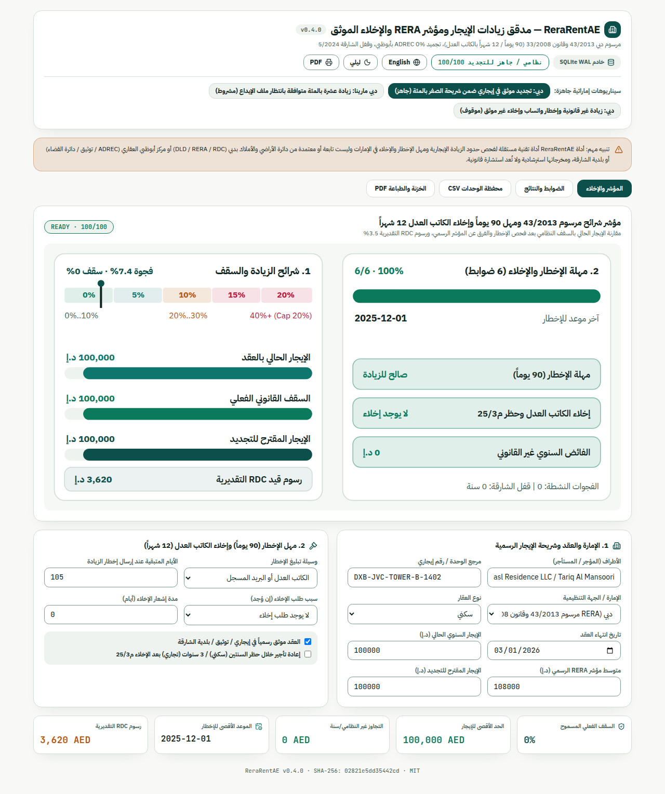
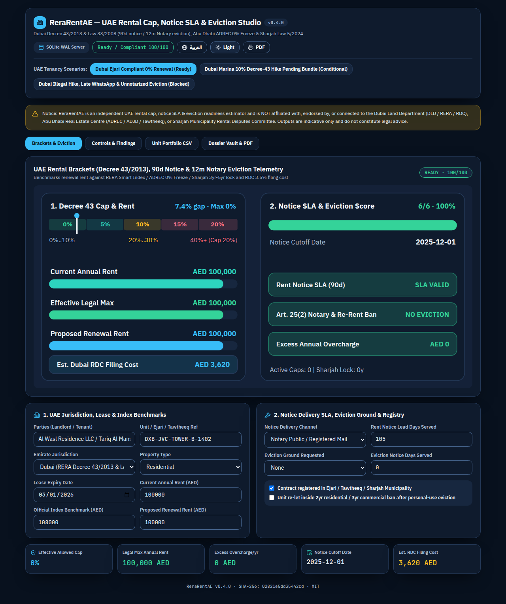
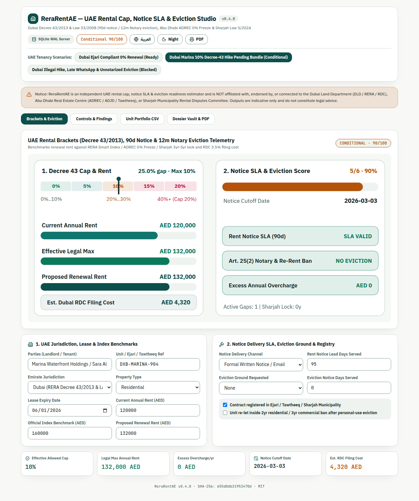
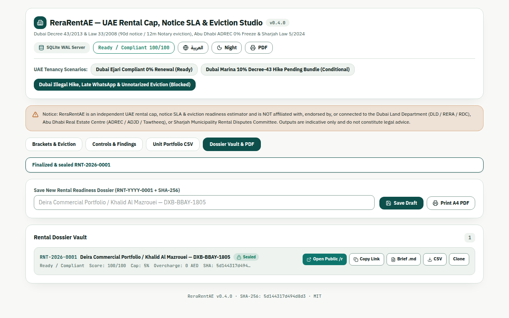
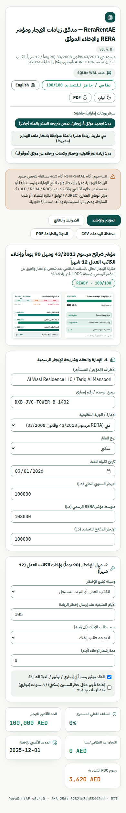
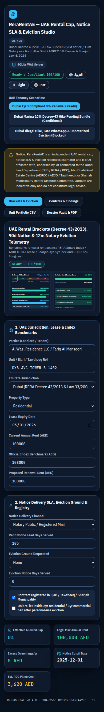

# ReraRentAE — مدقق زيادات الإيجار ومؤشر RERA والإخلاء الموثق الإماراتي

[](LICENSE)

> **Bilingual (`AR RTL` `Alabaster DLD` Light & `EN LTR` `Slate Night` Dark) · Dual-Mode (`Node 22 + SQLite WAL` or `$0` Browser Static Mode)**

Zero-runtime-backend-dependency UAE Rental Increase Cap, Notice SLA & Eviction readiness studio, `node:sqlite WAL` REST API server, and bilingual **Arabic (`RTL`) / English (`LTR`)** web workbench grounded in **Dubai Decree No. (43) of 2013 & Law No. (33) of 2008**, **Abu Dhabi ADREC `0%` Freeze / Law No. (20) of 2006 & Tawtheeq**, and **Sharjah Law No. (5) of 2024**:

- **Dubai Decree No. (43) of 2013 Brackets (`0% / 5% / 10% / 15% / 20%`)**: Evaluates renewal rent against the RERA Smart Rental Index (`<=10%` below market -> `0%`, `>10%..<=20% -> 5%`, `>20%..<=30% -> 10%`, `>30%..<=40% -> 15%`, `>40% -> 20%`).
- **Dubai Law No. (33) of 2008 `90-Day` Rent Notice & `12-Month` Notary Eviction**: Enforces Art. 14 written `90-day` pre-expiry rent modification notice, Art. 25(2) `365-day` (`12-month`) eviction strictly via **Notary Public or Registered Mail**, Art. 25(3) `2-year` residential / `3-year` commercial post-personal-use re-rent ban, and indicative Dubai **RDC `3.5%`** filing fees (`AED 500–20,000` + `AED 120` admin).
- **Abu Dhabi `ADREC 0%` Freeze / `Tawtheeq` & Sharjah `Law 5/2024`**: Supports ADREC `0%` freeze vs `5%` baseline with `60-day` residential / `90-day` commercial notice (`Law 20/2006 Art. 20`) and Sharjah `3-year` residential / `5-year` commercial initial lock + `2-year` subsequent lock.
- **CWE-1236 Safe Multi-Unit CSV Portfolio Auditor & Sealed Dossiers**: Neutralizes spreadsheet formula payloads (`=`, `+`, `-`, `@`, `\t`, `\r`), exports Excel-ready **`UTF-8 BOM` (`EF BB BF`) + `CRLF`** CSVs, mints atomic `RNT-YYYY-0001` dossiers with canonical **`SHA-256`** sealing (`409` immutable after lock), and serves read-only `/r/:slugOrCode` verification reports.

> **Independence & Legal Disclaimer / تنويه مهم:** ReraRentAE is an independent open-source UAE rental readiness estimator and is **NOT affiliated with, endorsed by, or connected to** the Dubai Land Department (`DLD`), Real Estate Regulatory Agency (`RERA`), Rental Disputes Center (`RDC`), Abu Dhabi Real Estate Centre (`ADREC / ADJD / Tawtheeq`), or Sharjah Municipality Rental Disputes Committee. Outputs are indicative only and do not constitute legal advice.

---

## Visual Showcase (`AR RTL` & `EN LTR`)

### Desktop Arabic RTL (`Alabaster DLD` Light — Dubai Ejari Compliant `0%` Renewal `100/100`)


### Desktop English LTR (`Slate Night` Dark)


### Dubai Marina Conditional Renewal (`25% below RERA Index -> 10% Allowed Cap`, Pending Archive `90/100`)


### Remediated Case & Sealed `RNT-2026-0001` Dossier (`SHA-256`)


### Mobile Arabic RTL View (`Alabaster DLD`, `390x844`)


### Mobile English LTR View (`Slate Night`, `390x844`)


---

## Quick Start (Local)

```bash
npm install
npm run typecheck
npm test
npm run build
npm start
# Opens HTTP + node:sqlite WAL backend on http://127.0.0.1:4239/rerarentae
```

See [`launch/DEPLOY-AND-SHARE.md`](launch/DEPLOY-AND-SHARE.md) for `$0` Cloudflare Workers static deployment, Docker Compose, and systemd setup.

## License

[MIT](LICENSE)
